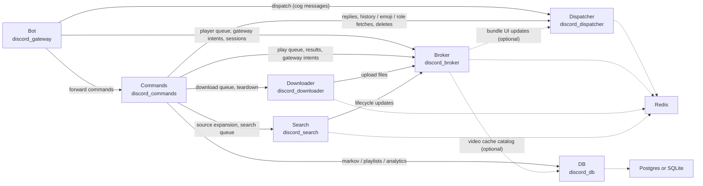

# Architecture

Describes how the bot runs in multi-pod mode, how the components communicate,
and what each pod is responsible for.

---

## HA is the only mode

There is no single-process mode any more — it was retired by the
discord-bot-ha-only project. The gateway pod holds the Discord connection and
parses commands; Discord API calls are handled exclusively by a dedicated
dispatcher pod, reached over HTTP via `HttpDispatchClient`
(`discord_core/clients/http_dispatch_client.py`), injected into every cog
via `CogHelperBase.__init__`. There is no `CogHelper._dispatcher` property
and no in-process fallback: `discord_gateway/cli/bot.py::run()` raises
`DiscordBotException` at startup if `general.dispatch_http_url` is missing.

The gateway pod separately requires `general.commands_http_url`, pointing at the
`discord-commands` pod — equally hard-required, equally no fallback (see [The
commands pod](#the-commands-pod)). It takes no `database_http_url`: the gateway
holds no database client (see [Database](./configuration.md#database)).

There are seven pods: `discord-gateway`, `discord-commands`,
`discord-dispatcher`, `discord-broker`, `discord-db`, `discord-downloader`
and `discord-search`.

---

## Components

Verified against each pod's own `Http*Client` construction, not reconstructed
from prose — see the per-pod notes below the diagram for what backs each
arrow.



The gateway talks only to the dispatcher, the broker and the commands pod: it
holds no client for the downloader, the search pod or the db pod. Those, with
the markov, playlist and analytics stores, belong to the commands pod (the
broker has its own narrower db clients).

Every solid arrow is an unconditional `Http*Client` the source pod always
constructs when the relevant cog/feature is enabled; every dashed arrow is
config-gated and silently skipped (with a warning) if the required URL is
missing:

- **Bot → Dispatcher** (`HttpDispatchClient`): hard-required — `bot.py::run()`
  raises at startup if `dispatch_http_url` is missing.
- **Bot → Commands** (`HttpCommandsClient`): hard-required — `bot.py::run()`
  raises at startup if `commands_http_url` is missing. One attempt per
  command, no retry; see [The commands pod](#the-commands-pod).
- **Bot → Broker** (`HttpBrokerClient`): constructed by the music cog. The gateway
  reads the broker's play queue and gateway intents, and plays what is queued.
- **Commands → Dispatcher** (`HttpGuildRolesClient`, a subclass of
  `HttpDispatchClient`) and **Commands → DB**
  (`HttpMarkovStore` / `HttpPlaylistStore` / `HttpGuildAnalyticsStore`): both
  hard-required — the commands pod raises at startup if `dispatch_http_url`
  or `database_http_url` is missing. Every reply a command makes goes out
  through the dispatcher, and so do the markov and delete-messages loops'
  history and emoji fetches and deletes, and the `role` commands' reads and
  changes of roles and members.
- **Commands → Broker / Search / Downloader** (`HttpBrokerClient`,
  `HttpMediaSearchClient` + `HttpYoutubeMusicSearchClient`,
  `HttpDownloadClient`): the music commands and result loops. All four
  `music.*_client.url` keys are hard-required by the commands pod. The broker
  is how the pod sees a guild's player and how it asks the gateway to act on
  it.
- **Bot → DB**: none. The gateway used to make one call, creating a guild's
  history playlist when its player started; the broker does that now, when the
  gateway opens the guild's queue (best-effort, off the request). The markov,
  playlist and music-stats *commands* and the markov loops use the commands
  pod's own stores.
- **Downloader → Broker**, **Search → Broker** (`HttpBrokerClient`):
  unconditional in both pods' `run()`.
- **Broker → Dispatcher** (`HttpDispatchClient`): only if
  `general.dispatch_http_url` is set; otherwise the broker tracks bundle
  state but never pushes a Discord message update.
- **Broker → DB** (`HttpVideoCacheStore`): only if
  `music.download.cache.enable_cache_files`, `general.database_http_url`,
  and `music.storage.bucket_name` are all set; otherwise the video cache is
  disabled for that broker instance.
- **Dispatcher, Broker, Downloader, Search → Redis**: each holds its own
  `RedisManager`; the bot, the commands pod and the db pod do not connect to
  Redis at all (the bot's `redis_manager` constructor param exists but is
  never wired to a real URL in `bot.py::run()`). The gateway and the commands
  pod coordinate through the broker and the dispatcher, never through Redis
  directly.
- **DB → Postgres or SQLite**: the only pod with a database engine; every other pod's
  `[database]` extra was removed along with its SQLAlchemy/asyncpg imports.

This is the only pod-to-pod picture — it's hand-drawn, but every edge on it
was checked against the code above, and it adds Redis, the database and the
solid/dashed unconditional-vs-config-gated distinction that a measurement
can't see. The measured detail behind it — exact route counts per edge,
straight from the `SEAM`/`ROUTES_CALLED` registries, so it cannot drift, not
a second diagram, a table — follows below, and it was cross-checked against
this diagram while writing it: the two agree on every edge.

### Which pod calls which

<!-- BEGIN GENERATED(seam-topology) by tests/cli/test_seam_topology.py. Do not edit this block by hand.
     Regenerate with: UPDATE_SEAM_TOPOLOGY=1 pytest tests/cli/test_seam_topology.py -->

The pod-to-pod HTTP topology, derived from the `SEAM` / `ROUTES_CALLED`
declarations the runtime route check already reads and from the registry each
server module imports. Measured by importing each image entrypoint in a clean
interpreter. Nothing here is hand-maintained and there is no prefix-to-pod map
written down anywhere, so it cannot drift from the registries.

A client class being reachable by import (what this measures) is not the same
as the call actually firing under some config, so an edge listed here as
unconditional may still be config-gated in practice at runtime — cross-check
the diagram above's solid/dashed distinction for that. What this adds beyond
the diagram is the exact route count behind each edge, broken out by prefix
where one seam is served by more than one pod.

**A seam is a route shape, not a pod.** Four of the five are served by exactly
one pod, but `queue_worker` is an abstract base subclassed twice -- at
`/downloads` on the downloader and `/search/ytmusic` on the search pod -- so
`discord-commands` has two separate dependencies there, not one. The search pod also
answers two different seams, `media_search` and `queue_worker`, behind one
composite app.

#### Edges

| caller | peer | seam | prefix | client | routes |
|---|---|---|---|---|---|
| `discord-broker` | `discord-db` | database | `/database/playlist` | `HttpHistoryPlaylistStore` | 16 |
| `discord-broker` | `discord-db` | database | `/database/guild_analytics` | `HttpPlayAnalyticsStore` | 2 |
| `discord-broker` | `discord-db` | database | `/database/video_cache` | `HttpVideoCacheStore` | 6 |
| `discord-broker` | `discord-dispatcher` | dispatch | — | `HttpDispatchClient` | 12 |
| `discord-commands` | `discord-broker` | broker | — | `HttpBrokerClient` | 39 |
| `discord-commands` | `discord-db` | database | `/database/guild_analytics` | `HttpGuildAnalyticsStore` | 2 |
| `discord-commands` | `discord-db` | database | `/database/markov` | `HttpMarkovStore` | 9 |
| `discord-commands` | `discord-db` | database | `/database/playlist` | `HttpPlaylistStore` | 16 |
| `discord-commands` | `discord-dispatcher` | dispatch | — | `HttpDispatchClient` | 12 |
| `discord-commands` | `discord-dispatcher` | dispatch | — | `HttpGuildRolesClient` | 12 |
| `discord-commands` | `discord-search` | media_search | — | `HttpMediaSearchClient` | 2 |
| `discord-commands` | `discord-downloader` | queue_worker | `/downloads` | `HttpDownloadClient` | 4 |
| `discord-commands` | `discord-search` | queue_worker | `/search/ytmusic` | `HttpYoutubeMusicSearchClient` | 4 |
| `discord-downloader` | `discord-broker` | broker | — | `HttpBrokerClient` | 39 |
| `discord-gateway` | `discord-broker` | broker | — | `HttpBrokerClient` | 39 |
| `discord-gateway` | `discord-commands` | commands | — | `HttpCommandsClient` | 2 |
| `discord-gateway` | `discord-dispatcher` | dispatch | — | `HttpDispatchClient` | 12 |
| `discord-search` | `discord-broker` | broker | — | `HttpBrokerClient` | 39 |

#### Seams

| seam | served by | called by | routes |
|---|---|---|---|
| broker | `discord-broker` | `discord-commands`, `discord-downloader`, `discord-gateway`, `discord-search` | 39 |
| commands | `discord-commands` | `discord-gateway` | 2 |
| database | `discord-db` | `discord-broker`, `discord-commands` | 33 |
| dispatch | `discord-dispatcher` | `discord-broker`, `discord-commands`, `discord-gateway` | 12 |
| media_search | `discord-search` | `discord-commands` | 2 |
| queue_worker | `discord-downloader`, `discord-search` | `discord-commands` | 8 |

#### Images that call no seam

`discord-db`, `discord-dispatcher`.

Serve-only pods. An image appearing here that should be calling something is the failure this doc makes visible.

<!-- END GENERATED(seam-topology) -->

---

## The commands pod

`discord-commands` (`discord_commands`) runs the logic behind the gateway's
commands (#1030). It has no Discord connection and no Discord token: the
gateway parses a command with discord.py, forwards it, and the commands pod
runs it and replies through the dispatcher.

1. A command stub in `discord_gateway/cogs/` builds a `CommandEnvelope` (who
   sent it, from which channel, in which voice channel, holding which roles)
   and the command's typed arguments, and calls
   `CogHelperBase.forward_command`.
2. `HttpCommandsClient` POSTs `POST /commands/{command}` to the commands pod
   (`general.commands_http_url`) — **one attempt**, with a 3 s accept timeout.
   A command is not idempotent (`play` twice queues twice), so nothing
   retries it.
3. The pod validates the arguments against the command's model
   (`discord_core/types/command_args.py`), queues the command and answers
   **202** — accepted, not run.
4. `CommandExecutor` runs each guild's commands one at a time, in arrival
   order, with one worker task per guild, so a slow command in one guild holds
   up no other. A command that raises is logged and its span marked as an
   error; the guild's next command still runs.
5. The command replies through the dispatcher
   (`POST /dispatch/send`), exactly as a gateway cog would.

If the pod cannot take a command (unreachable, refusing connections, timing
out) the gateway tells the user "Commands are unavailable right now" and drops
it. A 4xx means the stub sent something the pod does not accept, which is a
bug in the stub, and surfaces through `on_command_error`.

The seam is protected by a NetworkPolicy in the deployment repo rather than a
shared secret: only the gateway may reach the commands port.

Command groups move to the pod one at a time, in the same change that makes
the gateway forward them, so a command is never served by neither pod. Every
command has now moved:

| Group | Where it runs |
|---|---|
| `hello`, `roll`, `meta`, `urban` | commands pod |
| `markov on / off / list-channels / speak` | commands pod |
| `playlist create / list / show / delete / rename / item-remove / merge` | commands pod |
| `play`, `join`, `stop`, `skip`, `clear`, `shuffle`, `remove`, `bump`, `move-messages`, `history`, `random-play`, `music-stats`, `playlist item-add / queue / save-queue / save-history` | commands pod |
| `role list / users / available / add / remove` | commands pod (reads and changes roles through the dispatcher's REST fetches) |
| music result loops (`process_search_results`, `process_download_results`) | commands pod |
| markov and delete-messages loops | commands pod (`general.include`), through the dispatcher's history and emoji fetches |

The commands pod answers 501 for a known command it has no handler for, and
the gateway never asks it for one.

Two small things cross the boundary that the commands pod cannot look up
itself. `markov on` sends `channel_is_text_or_voice`, because the gateway
knows the type of the channel the command was typed in. The gateway also
polls the broker for **gateway intents**, the inbox through which other pods
ask it to do something only it can (join voice, stop, move the status
messages, wake a player); the gateway never receives a call from the commands
pod, so the pod graph stays acyclic.

The music commands have no player in the commands pod, so they reach it
through `BrokerPlayerGateway`, the pod's implementation of the
`PlayerGateway` Protocol (`discord_core/interfaces/player_gateway.py`):

- **Reading the player.** A guild has a player when the broker holds an open
  play queue for it (`GuildQueueSnapshot`: a text channel and not closed). It
  is playing when the broker has a playing track, and has pending downloads
  when the downloader reports a queue.
- **Asking it to act.** `join` submits a `join` intent and waits for the
  gateway to complete it (up to 35 s, past the 30 s an intent lives
  unclaimed), then reports its error to the channel. `stop`, `move_messages`
  and `wake` are asked and not awaited.
- **Cache hits.** A track found in the cache is registered and queued on the
  broker by the pod (`TrackQueuer`), then the player is woken.

The pod also runs the two **result loops** (`discord_commands/workers/result_loops.py`).
`process_search_results` pops a resolved search from the broker, cache-checks it
and submits the download; `process_download_results` pops a finished download
and queues it for the guild's player through `BrokerPlayerGateway.add_cached`,
which wakes the player with an intent. Both pops are destructive, so on shutdown
the pod lets an iteration in flight finish before it cancels the loops. Their
heartbeat series (`process_search_results`, `process_download_results`) are
published by `discord-commands`, not the gateway.

The pod also does a guild's **teardown** (`discord_commands/workers/guild_teardown.py`),
so the gateway need not reach the downloader or the search pod. When a guild's
player goes away the gateway's `cleanup()` calls
`POST /guilds/{guild_id}/teardown`, which answers 202 once the pod has taken the
job. The pod then clears the guild's queued downloads and searches, marks each
dropped request `DISCARDED`, blocks both queues for the guild and deletes its
bundles, keeping those of playlist adds still queued. It runs outside the
guild's command FIFO, so a `play` still enqueuing does not hold it up. The
gateway tries twice; if the pod stays unreachable it logs a warning and goes on
(queued work is then left to the result loop, bundles to their 24h TTL). A bot
restart skips the teardown: the queues are parked, not drained.

The **markov and delete-messages loops** run here too
(`discord_commands/workers/dispatch_loops.py`), when `general.include.markov` /
`delete_messages` are on in this pod's config. Each is a producer that asks the
dispatcher for channel history (and, for markov, guild emojis) on a timer and a
consumer of the per-cog result queue the dispatch client keeps; markov writes
the messages to the db pod, and delete-messages sends delete requests back
through the dispatcher. Nothing in them is destructive, so on shutdown they are
cancelled at once, and a result lost there is fetched again on the next sweep.
Run in only one pod at a time: two markov loops would write the same messages
twice. Their heartbeat and queue-depth series are published by `discord-commands`.

The `role` commands read the `role` section of this pod's config and ask
Discord for roles and members through the dispatcher (see [Awaitable
fetches](#awaitable-fetches-channel-history-guild-emojis-guild-roles)), since the
pod has no guild cache.

Because the executor runs a guild's commands one at a time, a `play` that is
still searching a large playlist holds up that guild's next command (a
`skip`, say) until it finishes enqueuing.

---

## Request flow

### Fire-and-forget (send, delete, mutable updates)

1. Cog calls e.g. `self.dispatch_message(guild_id, channel_id, 'text')`.
2. `self.dispatcher` (injected as an `HttpDispatchClient`) creates an async task
   that POSTs `{"guild_id": ..., "channel_id": ..., "content": ...}` to
   `POST /dispatch/send` on the dispatcher pod.
3. `DispatchHttpServer` extracts W3C traceparent from headers, enqueues the
   payload to the Redis sorted set, and returns 202.
4. A Redis worker (`_redis_worker`) on the dispatcher pod pops the item via
   `BZPOPMIN`, routes by member prefix, and calls the appropriate
   `MessageDispatcher` method, which issues the Discord API call with retry.

The cog does not wait for the Discord call to complete.

### Awaitable fetches (channel history, guild emojis, guild roles)

1. A cog, or one of the commands pod's loops, submits a `FetchChannelHistoryRequest`
   via `submit_request`.
2. `HttpDispatchClient` POSTs to `POST /dispatch/fetch_history`.
3. The server computes a stable `request_id` (SHA-256 of params), enqueues the
   fetch, and returns `{"request_id": "<hex>"}` with 202.
4. `HttpDispatchClient._poll_result()` polls
   `GET /dispatch/results/{request_id}` with exponential backoff
   (0.5 s base, 10 s max, 300 s timeout).
5. A Redis worker executes the history fetch, stores the result in Redis
   under `discord_bot:dispatch:result:{request_id}` (TTL 1 day), and the next
   poll returns 200 with the result body.
6. `HttpDispatchClient` decodes the result and delivers it to the cog's result
   queue (registered via `register_cog_queue`).

The `role` commands use the same submit-and-poll shape for four more fetches —
`fetch_roles`, `fetch_member`, `fetch_role_members` and `change_member_role` —
through `HttpGuildRolesClient`, which awaits the polled result instead of
queueing it. Because `request_id` is a hash of the body and a result is kept for a
day, each of these requests carries a fresh `call_id` that goes into the hash:
without it a second `role add` for the same member and role would be answered
with the first one's stored outcome and never reach Discord. Listing a role's
members pages the guild's members over REST, which needs `members` in the
dispatcher's `general.intents` (the dispatcher opens no gateway connection, so
this costs nothing there).

### Mutable bundle deduplication across pods

Mutable bundles (e.g. the music queue display) must not be updated concurrently
by two workers on different pods. The dispatcher uses a per-bundle Redis lock:

```
acquire SET NX discord_bot:dispatch:executing:{bundle_key}  (TTL 30 s)
    ↓ acquired
execute bundle flush
    ↓
release DEL discord_bot:dispatch:executing:{bundle_key}
```

If the lock is already held, the worker re-enqueues the sentinel at HIGH
priority and moves on. The lock TTL of 30 s is a safety net — if a pod dies
mid-execution, the lock expires and another pod can proceed within 30 s.

Bundle state is persisted to Redis (`discord_bot:bundle:{bundle_key}`, TTL 1 day)
after each flush, and loaded back on dispatcher startup so mutable messages
survive pod restarts.

---

## Redis key reference

The dispatcher's Redis key patterns and priority scoring are documented once,
in [Redis keys used by the dispatcher](message_dispatcher.md#redis-keys-used-by-the-dispatcher)
and [Priority levels](message_dispatcher.md#priority-levels) — not repeated
here.

---

## Configuration reference

### Dispatcher pod

The dispatcher pod's own config fields and a full `discord.dispatcher.cnf`
example are in [message_dispatcher.md's Configuration
section](message_dispatcher.md#configuration) — not repeated here.

### Redis connection: direct URL vs. Sentinel

`redis_url` connects to a single fixed endpoint. It is what production uses: one
Valkey pod behind the `redis-primary` Service, with an append-only file on a
persistent volume, so a restart or a reschedule to another node keeps the queues
and the saved player sessions but is an outage while the pod comes back (6.5
minutes on 2026-10-28, when it sat unschedulable during a node roll). Production
ran Valkey + Sentinel (three nodes, one primary) until 2026-07-20.

For a deployment that does run Sentinel, where the primary role floats across pods
on failover, set `redis_sentinel` instead so the client discovers the current
primary via Sentinel on every connection — a promotion is then transparent to the
app:

```yaml
general:
  # redis_sentinel takes precedence over redis_url when both are set.
  redis_sentinel:
    sentinels:
      - "redis-sentinel:26379"     # the redis-sentinel Service (one entry is enough; more sentinels are auto-discovered)
    service_name: "mymaster"       # the monitored primary's name (Sentinel's `mymaster`)
```

The same `redis_sentinel` block applies to the dispatcher, the broker, and any
process that opens Redis.

### Commands pod

```yaml
general:
  dispatch_http_url: "http://dispatcher:8082"   # every reply goes through it
  database_http_url: "http://db:8085"           # markov and playlist commands read and write here
  include:                                      # which background loops run in this pod
    markov: true
    delete_messages: true
  commands_server:
    host: 0.0.0.0
    port: 8086
markov:
  server_reject_list: []                        # guild ids markov refuses to run for
  loop_sleep_interval: 300                      # the markov loop's settings, as the cog had them
delete_messages:
  discord_channels: []                          # {server_id, channel_id, delete_after}
role: {}                                        # per-guild role rules, see role.md
music:
  general:
    message_delete_after: 300                   # seconds before playlist replies are removed
  playlist:
    server_playlist_max_size: 64                # most items a playlist holds; merge honours it
  player:
    queue_max_size: 128
  broker_client: {url: "http://broker:8081"}                 # all four urls are required
  download_client: {url: "http://downloader-host:8083"}
  youtube_music_search_client: {url: "http://search:8084"}
  media_search_client: {url: "http://search:8084"}
```

No `discord_token`, no `redis_url`. `discord_commands/cli/commands.py::run()`
raises `DiscordBotException` at startup if `dispatch_http_url`,
`database_http_url` or one of the four `music.*_client.url` keys is missing, and
a `role` section that does not validate stops it too. The `music.*` settings,
`markov.*`, `delete_messages.*` and `role.*` are read from this pod's config,
since those commands and loops run here (the pod has no cogs; it only reads
these keys). Without `general.include`, neither loop runs.

### Bot / cog pod

```yaml
general:
  discord_token: "YOUR_TOKEN"      # gateway connection
  dispatch_http_url: "http://dispatcher:8082"   # all dispatch calls go here
  commands_http_url: "http://commands:8086"     # forwarded commands go here
  include:
    default: true
    markov: true
    music: true
    role: true
music:
  broker_client: {url: "http://broker:8081"}    # the only music client the gateway holds
```

The gateway's `include` decides which command stubs it loads; the commands pod's
`include` decides which loops run. `delete_messages` is not a cog any more, so it
belongs to the commands pod's config only.

`dispatch_http_url` activates `HttpDispatchClient`, and `discord_gateway/cli/bot.py`
refuses to start without it — equally for `commands_http_url`, which
activates `HttpCommandsClient`. The gateway takes no `database_http_url`. There is no longer an
in-process fallback to fall back *to*: the single-process entrypoint that
built a local `MessageDispatcher` was retired, and the bot's own database
engine went with the same migration, so a missing URL is a startup
error rather than a quiet mode switch. `message_dispatcher` is not a valid
`include` key on this pod — `MessageDispatcher` is the separate dispatcher
pod's own worker, not one of `POSSIBLE_COGS`.

---

## Observability

Trace propagation, the dispatcher's span reference, and its metrics all live
in the dedicated monitoring docs now: see [Dispatcher trace
propagation](monitoring/trace_linking.md#dispatcher-trace-propagation) for
how context crosses the HTTP+Redis hop and the full span table, and
[Metrics Reference](monitoring/metrics_reference.md#messagedispatcher-metrics)
for `message_dispatcher_queue_depth` (**planned, not currently emitted** — do
not treat it as a real series), and the
`heartbeat{background_job="message_dispatcher"}` loop-health gauge.

---

## Docker Compose

`docker/docker-compose.multiprocess.yml` starts the full split. The downloader
comes in two flavours behind two **mutually exclusive profiles** — pick one; the
core services have no profile and always start:

| Service | Profile | Image | Purpose |
|---------|---------|-------|---------|
| `redis` | — | `redis:7-alpine` | Shared state; persisted via named volume |
| `postgres` | — | `postgres:16-alpine` | Bare postgres — **no `discord-db` service sits on top of it** (see caveat below) |
| `dispatcher` | — | `Dockerfile.dispatcher` | HTTP server + Redis worker; makes outbound Discord REST calls on the bot's behalf |
| `broker` | — | `Dockerfile.broker` | S3 media checkout/release; persists and serves download/search results to the bot |
| `search` | — | `Dockerfile.search` | Standalone search tier; the commands pod's search and media-search clients call it, and resolutions return via the broker |
| `commands` | — | `Dockerfile.commands` | Runs the commands the gateway forwards and the music, markov and delete-messages loops (no Discord token); replies through the dispatcher |
| `bot` | — | `Dockerfile.gateway` | Holds the actual Discord gateway connection and the voice player; parses commands and forwards them; plays what the broker has queued |
| `downloader-direct` | `local` | `Dockerfile.downloader` | Download worker with no tunnel — default egress, **no Mullvad key** |
| `gluetun` | `vpn` | `qmcgaw/gluetun` | One Mullvad WireGuard tunnel; `downloader-vpn` shares its netns |
| `downloader-vpn` | `vpn` | `Dockerfile.downloader` | Download worker, in-tunnel, per-download SOCKS5 exits (prod shape) |

**This compose file has no `db` service.** `discord-db` (`Dockerfile.db`, port
8085) is a real, separate pod in production, but nothing in
`docker/docker-compose.multiprocess.yml` builds or runs it — the `postgres`
service above is bare postgres with no HTTP API in front of it. Since
the commands pod's `run()` hard-requires `general.database_http_url` (and the
broker needs it to record plays), the `commands` and `broker` services as
checked in cannot actually reach a database through this compose file; the
`bot` service needs none. Treat the compose file's database wiring as incomplete rather than a
working reference until a `db` service is added.

**Contributor default — no Mullvad account needed:**

```bash
cp docker/.env.example docker/.env      # Discord + music creds; leave MULLVAD_* blank
docker compose -f docker/docker-compose.multiprocess.yml --profile local up -d --build
```

**Prod shape, with per-download Mullvad exits:**

```bash
cp docker/.env.example docker/.env      # ...plus a real MULLVAD_WG_PRIVATE_KEY
docker compose -f docker/docker-compose.multiprocess.yml --profile vpn up -d --build
```

gluetun never reports healthy without a real Mullvad key and the downloader is
gated on `service_healthy`, which is why the pair sits behind a profile: without
it, a contributor with no key cannot bring the stack up at all.

Both flavours answer to the network alias **`downloader-host`**, so
`discord.bot.cnf` points at `http://downloader-host:8083` either way (for the
tunnel flavour the alias lives on `gluetun`, since `downloader-vpn` shares its
netns and has no network identity of its own). Nothing in the bot config changes
when you switch profiles.

Config files go in `volumes/cnf/` (copy the `docker/*.cnf.example` files):
`discord.dispatcher.cnf`, `discord.broker.cnf`, `discord.search.cnf`,
`discord.commands.cnf`, `discord.bot.cnf`, and the downloader config for your profile —
`discord.downloader.direct.cnf` for `local`, `discord.downloader.cnf` (which
carries the `mullvad-socks5` egress block, see
[Egress Modes](./music.md#egress-modes)) for `vpn`. Each is mounted at
`/opt/discord/cnf/discord.cnf` in its container.

### Startup order

There is no single linear order — each service's `depends_on` only names
what it actually needs, and compose only serializes along those edges:

| Service | Waits on | Condition |
|---|---|---|
| `redis`, `postgres` | — | (no dependencies) |
| `dispatcher` | `redis` | started |
| `commands` | `dispatcher`, `broker`, `search` | healthy, started, started |
| `broker` | `redis`, `postgres` | started, healthy |
| `downloader-direct` (`local`), `search` | `redis`, `broker` | started, started |
| `downloader-vpn` (`vpn`) | `gluetun`, `redis`, `broker` | healthy, started, started |
| `bot` | `redis`, `dispatcher`, `commands` | started, healthy, started |

Two things worth calling out, since the pod diagram above could suggest
otherwise:

**`dispatcher` has no `depends_on` entry for `broker`, `downloader`, or
`search` at all** — it only waits on `redis`, so compose is free to start it
in parallel with `broker` rather than strictly after it.

**`bot` waits on `commands` but not on `broker`**, although the gateway is an
`HttpBrokerClient` of it (see [Components](#components)), and it names no
downloader or search entry at all: the gateway no longer calls either, the
commands pod does. The broker has no startup gate because every `Http*Client`,
including `HttpBrokerClient`, routes its outbound calls through
`HttpClientMixin._call()`, which retries via `async_retry_broker_command()` — up
to 3 attempts with exponential backoff on a connection failure — so a call made
before the broker is ready fails and retries on that one call rather than
blocking startup. `dispatcher` is the one pod `bot` hard-gates on
(`condition: service_healthy`), even though `HttpDispatchClient` layers its own
circuit breaker on top of the same retry primitive; the compose file doesn't say
why dispatcher gets a startup gate and broker doesn't, so treat that as a real
asymmetry rather than an oversight until confirmed otherwise.

### Testing SOCKS5 egress

`downloader-vpn` runs `network_mode: service:gluetun`, so it egresses each download
through a different Mullvad exit's SOCKS5 over the one tunnel. gluetun keeps the
compose network off the tunnel (`FIREWALL_OUTBOUND_SUBNETS` + `DOT: off` /
`DNS_ADDRESS: 127.0.0.11`) so redis/broker stay reachable. Play a track, then watch
which exit each download left from:

```bash
docker compose -f docker/docker-compose.multiprocess.yml logs -f downloader-vpn | grep "egress via exit"
```

> **Note:** neither downloader config has an S3 bucket configured, so finished files stay local
> and won't play back (the bot can't read the downloader's disk). That's enough to
> validate egress; for real end-to-end playback add a MinIO service and a bucket to
> the downloader/broker/bot configs.

## Container runtime details

### Non-root user and volume permissions

Every image runs as a non-root `discord` user (UID/GID 1000). The entrypoint
script (`docker-entrypoint.sh`) creates its own subdirectories under
`/opt/discord` (`/opt/discord/cnf`, `/opt/discord/downloads`) if they don't
already exist, checks that mounted volumes are writable, and warns if they
aren't — so an empty host directory works, but it (and `/var/log/discord`)
must be owned by UID/GID 1000 on the host (`chown -R 1000:1000`), or the
container must be run with `--user $(id -u):$(id -g)`, which can itself
mismatch permissions baked into the image. See [Config File
Location](./configuration.md#config-file-location) for where each pod
expects its config mounted.

### Health checks

Every image ships a `HEALTHCHECK`, but only the bot's actually exercises the
health server's `/health` endpoint — the other six probe a raw TCP
connection to the pod's own application port instead (the commands image
probes 8086, the port the gateway calls, because its `/health` only says the
process is up). See [Health server
documentation](./monitoring/health_server.md#docker-integration) for the
full breakdown and [Health Check](./configuration.md#health-check) for the
config toggle.

### No database driver outside the db image

The bot image (`docker/Dockerfile.gateway`) and the commands image
(`docker/Dockerfile.commands`) carry no database driver
(PostgreSQL or SQLite) — SQLAlchemy, asyncpg and aiosqlite are not among
`discord_core`'s, `discord_gateway`'s or `discord_commands`'s dependencies, since neither pod talks to the database any other way than over HTTP (see
[Database](./configuration.md#database)). The driver is installed only in
the `discord-db` image (`docker/Dockerfile.db`), the sole image that opens a
real database connection and runs the alembic migrations.
