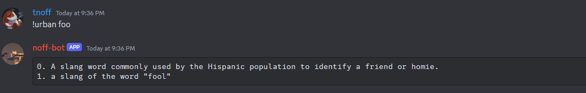

# Urban Dictionary Cog

Lookup a word in urban dictionary and get a definition.

The gateway only parses this command and forwards it to the `discord-commands` pod
(`general.commands_http_url`), which runs it and replies through the dispatcher. If that pod
cannot take the command, the bot answers that commands are unavailable and does not retry.

```
!urban

Lookup word on urban dictionary

search: str [Required]
    The word or phrase to search in urban dictionary

Arguments:
  word No description given
```

Example: 
